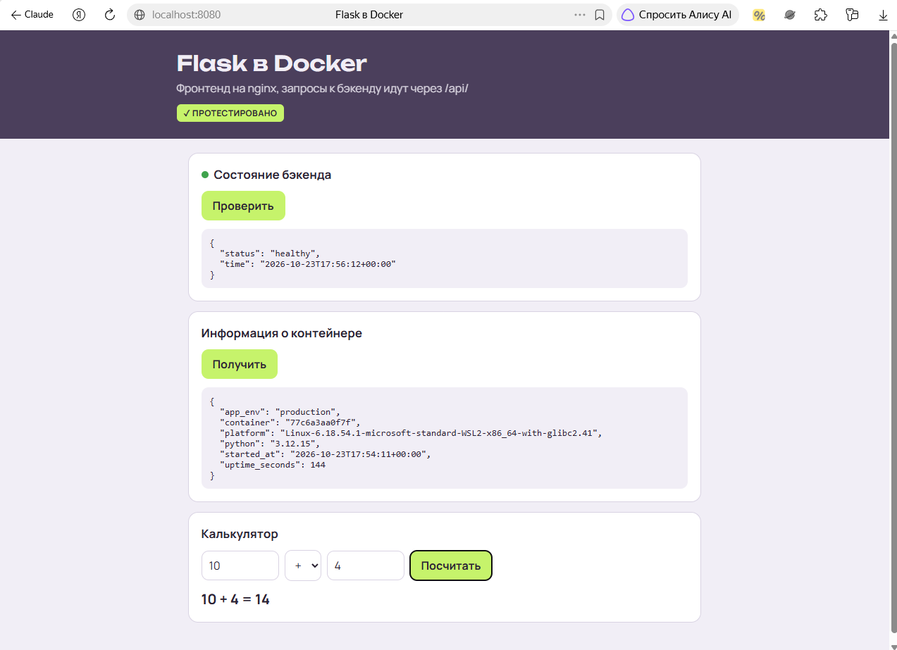
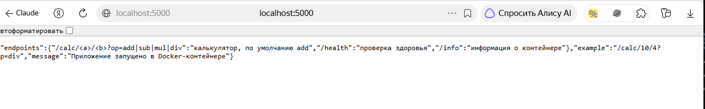
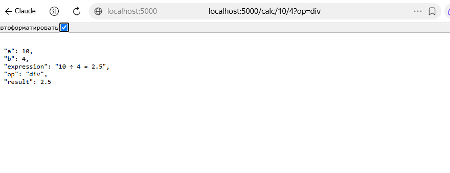
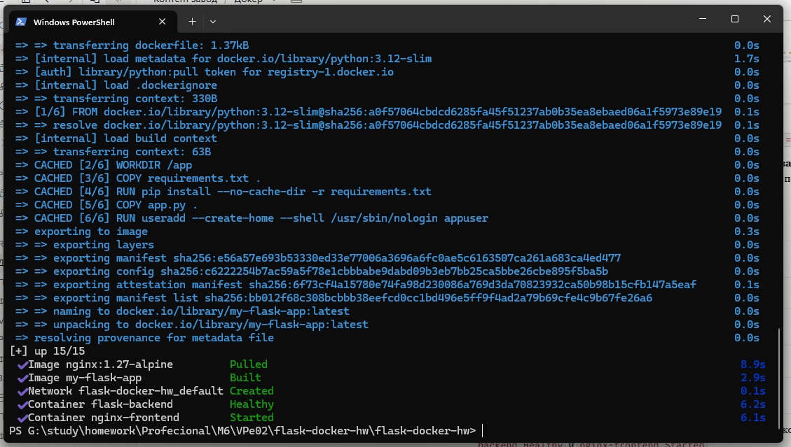
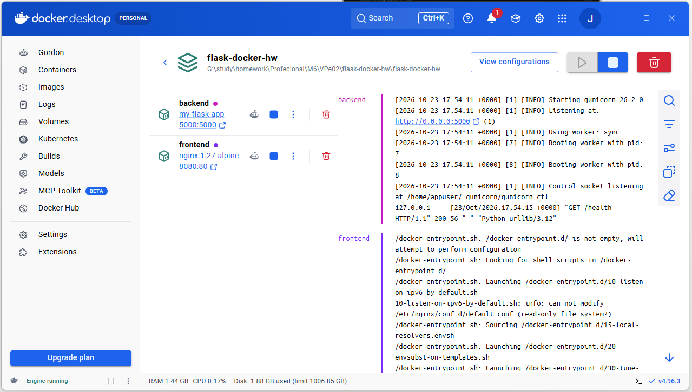

# Flask в Docker — ДЗ VPe02 «Docker для вайбкодера»

Простое Flask-приложение с калькулятором, упакованное в Docker-контейнер, плюс веб-интерфейс на nginx, объединённый с бэкендом через Docker Compose.

**Стек:** Python 3.12 · Flask · gunicorn · Docker · Docker Compose · nginx · pytest



## Что внутри

```
flask-docker-hw/
├── backend/
│   ├── app.py              # Flask-приложение
│   ├── requirements.txt    # flask, gunicorn
│   ├── Dockerfile          # сборка образа
│   ├── .dockerignore       # что НЕ попадает в образ (.env, базы, тесты)
│   ├── tests/test_app.py   # 19 автотестов
│   └── pytest.ini
├── frontend/
│   ├── index.html          # страница: состояние, инфо, калькулятор
│   └── nginx.conf          # проксирует /api/ → backend:5000
└── docker-compose.yml      # бэкенд + фронтенд одной командой
```

## Эндпоинты

| Адрес | Что делает |
|---|---|
| `GET /` | приветствие и список эндпоинтов |
| `GET /info` | ID контейнера, версия Python, платформа, аптайм |
| `GET /calc/<a>/<b>?op=add\|sub\|mul\|div` | калькулятор, по умолчанию `add` |
| `GET /health` | проверка здоровья (её использует Docker) |

Примеры: `/calc/10/4?op=div` → 2.5, `/calc/-5/3` → −2, `/calc/10/0?op=div` → 400 «Деление на ноль».

## Запуск

Нужен запущенный Docker Desktop («Docker Desktop is running» с зелёной точкой).

### Вариант 1 — одним контейнером (пункт 2 задания)

```bash
cd backend
docker build -t my-flask-app .
docker run -d -p 5000:5000 --name my-flask-app my-flask-app
```

Проверка: http://localhost:5000, http://localhost:5000/info, http://localhost:5000/calc/10/4?op=mul

Остановить и удалить контейнер перед вариантом 2 (иначе порт 5000 будет занят):

```bash
docker rm -f my-flask-app
```

### Вариант 2 — через Docker Compose (пункт 3 задания)

Из корня проекта:

```bash
docker compose up -d --build
```

- Бэкенд: http://localhost:5000
- Веб-интерфейс: http://localhost:8080

Остановить: `docker compose down`

> ⚠️ **Не путать с `docker compose down -v`** — флаг `-v` удаляет тома вместе с данными. Здесь томов с данными нет, но в проекте с базой это удалит всю базу.

### Автотесты (без Docker)

```bash
cd backend
pip install -r requirements.txt -r requirements-dev.txt
pytest -q
```

## Что сделано иначе, чем в уроке, и почему

| В уроке | Здесь | Зачем |
|---|---|---|
| `/` отдаёт `dict(os.environ)` | `/info` отдаёт только безопасные поля | В реальном проекте в окружении лежат токены и ключи API; есть тест, что они не утекают |
| `<int:a>` в маршруте | разбор числа вручную | `<int:>` отвечает 404 на `-5` и `2.5`; деление на ноль и мусор дают понятный 400 |
| `python app.py` (dev-сервер Flask) | gunicorn | Flask сам предупреждает: dev-сервер не для продакшена |
| контейнер от root | пользователь `appuser` | меньше вреда при взломе |
| healthcheck через `curl` | через Python | в образе `python:*-slim` нет curl, проверка из урока всегда падала бы |
| ошибка `backend:5000 ERR_NAME_NOT_RESOLVED` лечится `driver: host` | nginx проксирует `/api/` на `backend:5000` | браузер не знает внутренние имена Docker, а nginx внутри сети — знает; режим host плохо работает в Docker Desktop на Windows |
| нет `.dockerignore` | есть | `.env`, базы и тесты не попадают в образ |
| фронтенд на порту 80 | порт 8080 | на Windows порт 80 часто занят |
| фронтенд стартует сразу | ждёт `service_healthy` | страница не открывается раньше, чем бэкенд готов |

## Если образы не скачиваются

Ошибка `Forbidden` или `context deadline exceeded` при `docker build` / `docker compose up` значит, что не удаётся скачать базовые образы из Docker Hub. Можно добавить зеркало: Docker Desktop → Settings → Docker Engine, в JSON дописать

```json
"registry-mirrors": ["https://mirror.gcr.io"]
```

→ Apply & restart. Перед этим стоит проверить, что выбранное зеркало сейчас работает.

## Проверка работы

**Бэкенд в одном контейнере** — http://localhost:5000





**Docker Compose** — бэкенд прошёл healthcheck, фронтенд запущен



**Docker Desktop** — два контейнера; в логах gunicorn и проверки `/health`


